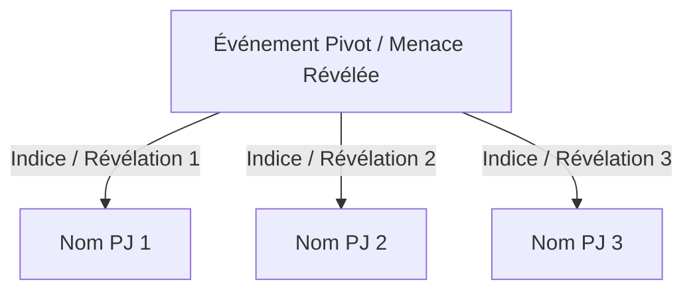

# Modèle de Référence : Compte Rendu de Séance

Ce document définit la structure standard et les recommandations pour rédiger le compte rendu d'une séance de jeu.

```markdown
# Séance [XX] : [Titre de la Séance]

> 🛡️ *Vérifié : NON_VALIDE | Modifié : [DATE_DU_JOUR]*

* **Campagne :** [Nom de la Campagne avec lien Markdown vers son README]
* **Date en jeu :** [Repère temporel narratif, ex. Jour 12, An 514]
* **Théâtre des Événements :** [Lieux géographiques avec liens relatifs vers 06_lieux/ ou 02_geographie/]
* **Protagonistes :** [Liste des PJ présents avec liens relatifs vers leurs dossiers dans 05_personnages/Joueurs/]
* **Coutumes, fêtes & événements apparus :** [Liens vers les fiches dans 03_societe_et_politique/coutumes_fetes_et_evenements/ ; liens vers 10_chronologie/ pour les occurrences jouées. Écrire « Aucun » le cas échéant.]

---

## 1. Synopsis des Événements

[Récit fluide à la troisième personne dans un registre notarial objectif. Divisez le texte en paragraphes cohérents ordonnés chronologiquement du début à la fin de la séance. Aucun dialogue ni détail ne doit être inventé au-delà des éléments fournis par le MJ.]

---

## 2. Les Accroches des Protagonistes (Indices Clés)

[Si la séance a fait émerger des révélations ou indices reliant l'événement pivot aux différents PJ, générez un diagramme Mermaid de liaison :]



### [Nom PJ 1] — [Titre de l'Accroche]
* **Élément Découvert / Obtenu :** [Description factuelle de ce qui s'est produit en séance]
* **Impact Narratif & Psychologique :** [Résonance avec le passé, les objectifs ou les relations du personnage]

### [Nom PJ 2] — [Titre de l'Accroche]
* **Élément Découvert / Obtenu :** [...]
* **Impact Narratif & Psychologique :** [...]

---

## 3. Phases Saillantes de la Séance

1. **[Phase 1 - Nom synthétique] :** [Bref résumé opérationnel de l'épisode en 1 à 2 phrases denses.]
2. **[Phase 2 - Nom synthétique] :** [...]
3. **[Phase 3 - Nom synthétique] :** [...]

---

## 4. Journal Mécanique & Ressources (Uniquement sur demande expresse du MJ)

* **Rencontres & Combats :** [Adversaires affrontés, issue tactique, tours marquants.]
* **Blessures Permanentes & États :** [Séquelles durables, malédictions ou dettes contractées.]
* **Butin & Monnaie :** [Pièces trouvées/dépensées, matériaux récupérés, consommables utilisés.]
* **Objets Magiques Attribués :** [Objets magiques singuliers avec lien vers 08_objets_magiques_singuliers/.]
```
