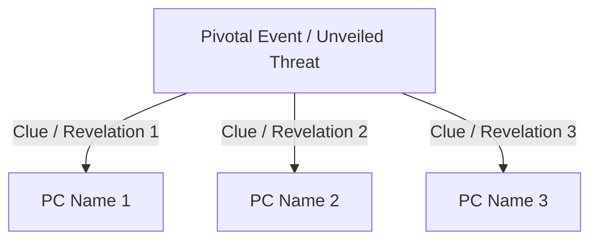

# Reference Template: Session Minutes

This document defines the standard structure and guidelines for drafting game session minutes.

```markdown
# Session [XX]: [Session Title]

> 🛡️ *Verified: UNVERIFIED | Modified: [TODAY_DATE]*

* **Campaign:** [Campaign Name with Markdown link to its README]
* **In-Game Date:** [Narrative temporal reference, e.g. Day 12, Year 514]
* **Theatre of Events:** [Locations with relative links to dossiers in 06_locations/ or 02_geography/]
* **Protagonists:** [List of present PCs with relative links to dossiers in 05_characters/Player_Characters/]
* **Customs, Festivals & Events Surfaced:** [Links to sheets in 03_society_and_politics/customs_festivals_and_events/ for introduced/mentioned items; links to 10_timeline/ for staged occurrences. Write "None" if none were involved.]

---

## 1. Synopsis of Events

[Fluid third-person narrative in an objective, notarial register. Divide into coherent paragraphs ordered chronologically from opening events to the session's close. No dialogue or detail may be invented beyond what the DM provided.]

---

## 2. Protagonist Hooks (Key Clues)

[If the session surfaced revelations or clues linking the pivotal event to individual PCs, generate a connecting Mermaid diagram:]



### [PC Name 1] — [Hook Title]
* **Element Recognised / Obtained:** [Objective description of what emerged in play]
* **Narrative & Psychological Impact:** [Resonance with the character's backstory, aims, or relationships]

### [PC Name 2] — [Hook Title]
* **Element Recognised / Obtained:** [...]
* **Narrative & Psychological Impact:** [...]

---

## 3. Key Phases of the Session

1. **[Phase 1 - Concise Name]:** [Brief operational summary of the event in 1–2 information-dense sentences.]
2. **[Phase 2 - Concise Name]:** [...]
3. **[Phase 3 - Concise Name]:** [...]

---

## 4. Mechanical Log & Resources (Only if expressly requested by the DM)

* **Encounters & Combat:** [Foes faced, tactical outcome, notable rounds.]
* **Permanent Injuries & Conditions:** [Persistent wounds, curses, or debts incurred.]
* **Loot & Coinage:** [Coin found/spent, salvaged materials, consumables expended.]
* **Magic Items Assigned:** [Unique magic items with links to 08_unique_magic_items/.]
```
