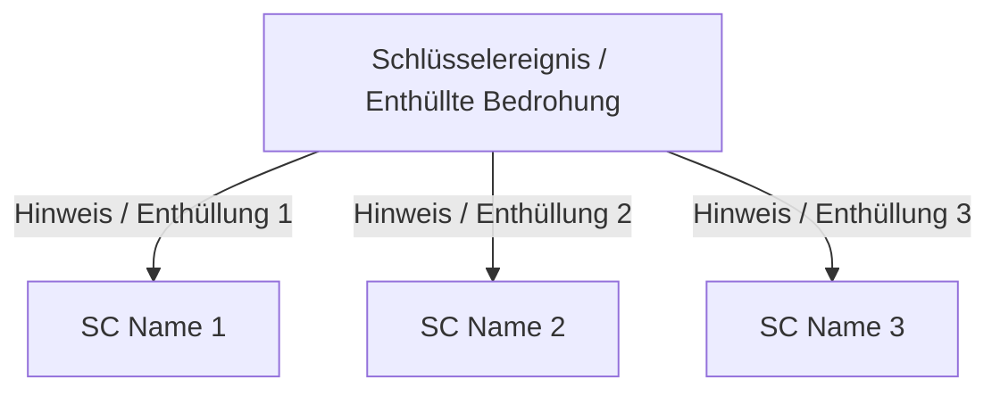

# Referenzvorlage: Sitzungsprotokoll

Dieses Dokument legt die Standardstruktur und Leitlinien für das Verfassen eines Spielsitzungsprotokolls fest.

```markdown
# Sitzung [XX]: [Sitzungstitel]

> 🛡️ *Geprüft: NICHT_GEPRUEFT | Geändert: [HEUTIGES_DATUM]*

* **Kampagne:** [Kampagnenname mit Markdown-Link zur zugehörigen README]
* **Ingame-Datum:** [Narrativer Zeitbezug, z. B. Tag 12, Jahr 514]
* **Schauplatz der Ereignisse:** [Orte mit relativen Links zu Dossiers in 06_orte/ oder 02_geografie/]
* **Protagonisten:** [Liste anwesender SCs mit relativen Links zu ihren Dossiers in Band V (z. B. 05_charaktere/Spielercharaktere/)]
* **Aufgetretene Bräuche, Feste & Ereignisse:** [Links zu Bögen in 03_gesellschaft_und_politik/braeuche_feste_und_ereignisse/ für eingeführte/erwähnte Einträge; Links zu 10_zeitlinie/ für gespielte Vorkommnisse. „Keine“ angeben, falls nicht betroffen.]

---

## 1. Zusammenfassung der Ereignisse

[Flüssige Erzählung in der dritten Person in sachlichem Notariatsstil. Gliedere den Text in stimmige, chronologisch vom Beginn bis zum Ende der Sitzung geordnete Absätze. Es dürfen keinerlei Dialoge oder Details über die Angaben des SL hinaus erfunden werden.]

---

## 2. Die Aufhänger der Protagonisten (Schlüsselhinweise)

[Hat die Sitzung Enthüllungen oder Hinweise hervorgebracht, die das Schlüsselereignis mit einzelnen SCs verknüpfen, erstelle ein verbindendes Mermaid-Diagramm:]



### [SC Name 1] — [Titel des Aufhängers]
* **Erkanntes / Erhaltenes Element:** [Objektive Beschreibung des im Spiel eingetretenen Sachverhalts]
* **Narrative & Psychologische Wirkung:** [Anklang an Hintergrundgeschichte, Ziele oder Beziehungen des Charakters]

### [SC Name 2] — [Titel des Aufhängers]
* **Erkanntes / Erhaltenes Element:** [...]
* **Narrative & Psychologische Wirkung:** [...]

---

## 3. Schlüsselphasen der Sitzung

1. **[Phase 1 - Kurzname]:** [Kompakte operative Zusammenfassung des Geschehens in 1–2 informationsdichten Sätzen.]
2. **[Phase 2 - Kurzname]:** [...]
3. **[Phase 3 - Kurzname]:** [...]

---

## 4. Regelprotokoll & Ressourcen (Nur auf ausdrücklichen Wunsch des SL)

* **Begegnungen & Kämpfe:** [Bekämpfte Gegner, taktischer Ausgang, markante Runden.]
* **Bleibende Verletzungen & Zustände:** [Anhaltende Wunden, Flüche oder eingegangene Schulden.]
* **Beute & Münzen:** [Gefundene/ausgegebene Münzen, geborgene Materialien, verbrauchte Vorräte.]
* **Vergebene magische Gegenstände:** [Einzigartige magische Gegenstände mit Link zu 08_besondere_magische_gegenstaende/.]
```
