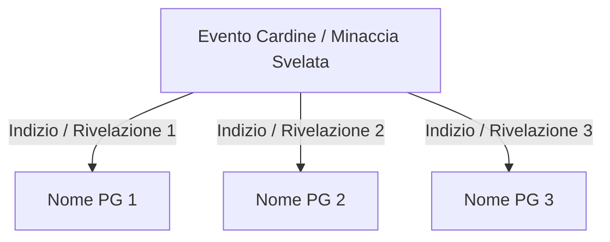

# Template di Riferimento: Verbale di Sessione

Questo documento definisce la struttura standard e le linee guida per la stesura del verbale di una sessione di gioco.

```markdown
# Sessione [XX]: [Titolo della Sessione]

> 🛡️ *Verificato: NON_CONVALIDATO | Modificato: [DATA_ODIERNA]*

* **Campagna:** [Nome Campagna con link Markdown al relativo README]
* **Data in-game:** [Riferimento temporale narrativo, es. Giorno 12, Anno 514]
* **Teatro degli Eventi:** [Luoghi geografici con link relativi ai dossier se presenti in 06_luoghi/ o 02_geografia/]
* **Protagonisti:** [Elenco dei PG presenti con link relativi ai loro dossier nel Tomo V (es. 05_personaggi/Giocanti/)]
* **Usi, costumi ed eventi emersi:** [Link alle schede in 03_societa_e_politica/usi_costumi_ed_eventi/ per usanze, festival o eventi introdotti/menzionati; link alla 10_timeline/ per le occorrenze svolte. Scrivere "Nessuno" se la sessione non ne ha toccati.]

---

## 1. Sinossi degli Eventi

[Narrazione fluida in terza persona con registro notarile e distaccato. Il testo deve essere suddiviso in paragrafi coerenti, ordinati cronologicamente dai fatti iniziali alla chiusura della sessione. Nessun dialogo o dettaglio deve essere inventato oltre a quanto fornito dal Master.]

---

## 2. I Ganci dei Protagonisti (Indizi Chiave)

[Se la sessione ha fatto emergere rivelazioni o indizi che legano l'evento cardine ai singoli PG, genera un diagramma Mermaid di raccordo:]



### [Nome PG 1] — [Titolo del Gancio]
* **Elemento Riconosciuto/Ottenuto:** [Descrizione oggettiva del fatto emerso in sessione]
* **Impatto Narrativo & Psicologico:** [Risonanza con la backstory, gli obiettivi o le relazioni del personaggio]

### [Nome PG 2] — [Titolo del Gancio]
* **Elemento Riconosciuto/Ottenuto:** [...]
* **Impatto Narrativo & Psicologico:** [...]

---

## 3. Fasi Salienti della Sessione

1. **[Fase 1 - Nome sintetico]:** [Breve sintesi operativa dell'avvenimento in 1-2 frasi ad alta densità informativa.]
2. **[Fase 2 - Nome sintetico]:** [...]
3. **[Fase 3 - Nome sintetico]:** [...]

---

## 4. Registro Meccanico & Risorse (Solo se espressamente indicato dal DM)

* **Incontri & Combattimenti:** [Nemici affrontati, esito tattico, round salienti.]
* **Danni Permanenti & Condizioni:** [Eventuali ferite persistenti, maledizioni, debiti contratti.]
* **Bottino & Monete:** [Monete trovate/spese, materiali recuperati, consumabili impiegati.]
* **Oggetti Magici Assegnati:** [Oggetti magici unici con link a 08_oggetti_magici_peculiari/.]
```
